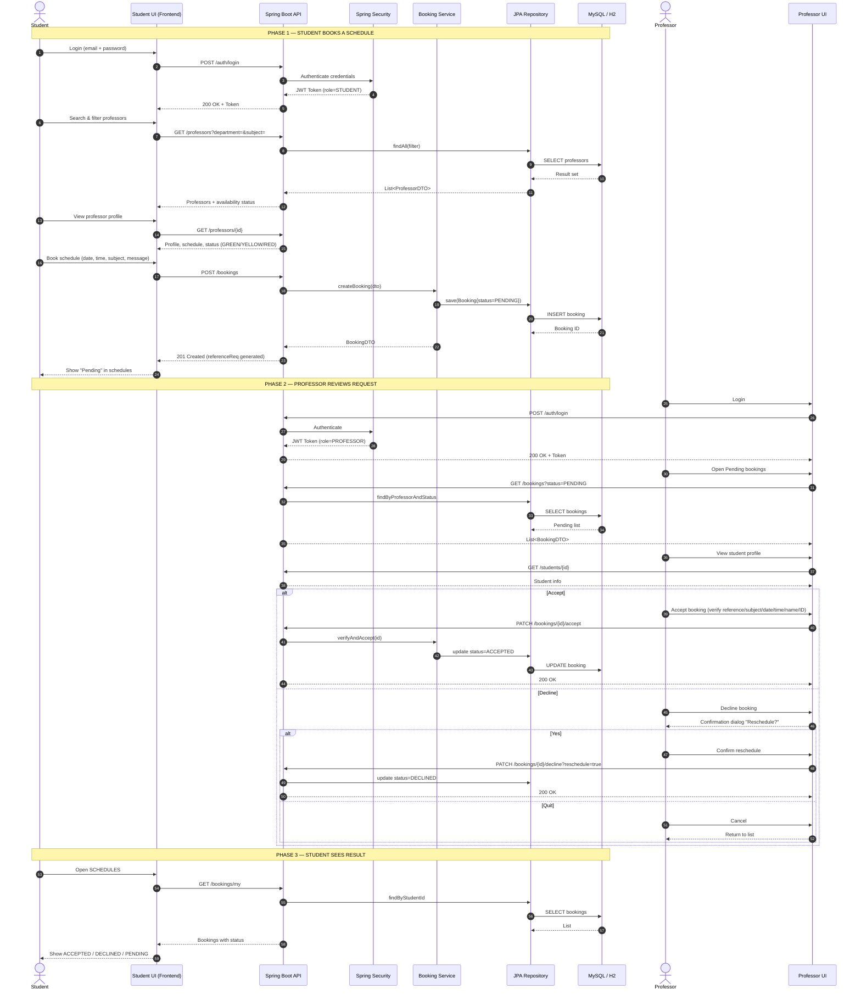

# CATC-Queue
CATC-Queue is a platform for students who are constantly missing their schedule in term exams. This Web app can help them to book a schedule for their professor. Students can see the schedule they booked, the time, and day. Professors will have a separated account where they can post their availability and the schedule of examination.

# Flowchart

# Flowchart Description

The flowchart models the complete user journey across all three roles from the moment the application opens.

## Entry & Authentication
The flow begins when a user visits the app and is routed to the login page. Spring Security validates credentials. If invalid, the user is returned to login. If valid, the system branches by role into Student, Professor, or Admin dashboards.

## Student Path
The student sees the navigation bar (HOME, SCHEDULES, PROFILE, SETTINGS, HELP). On HOME, they search and filter professors, view profiles, and check the three-circle availability indicator (green = available, yellow/orange = break, red = unavailable). If they choose to book, they select date, time, subject, and message, generating a booking with status PENDING and a unique referenceReq. They can view history and request cancellation, but cancellation requires professor approval. They can also edit profile, change theme (Navy / Light / Dark), and access help.

## Professor Path
The professor dashboard shows a calendar of activity and pending bookings. For each request, the professor can Accept (after verifying the reference matches exactly, plus subject, date, time, name, and student ID) or Decline. Declining triggers a confirmation dialog ("Do you want it rescheduled?") with Yes / Quit options. Accepted bookings become ACCEPTED; declined ones become DECLINED and may prompt the student to reschedule. The professor can also set their own status (RED/GREEN/YELLOW), manage schedules, edit subjects/department/contacts, and view student profiles.

## Admin Path
The admin manages user accounts and roles, booking reference records, views all system records, and deletes bookings when appropriate.

# Convergence
All role-specific flows terminate at the same end node, reflecting that each session ends after the user completes their tasks.

# Sequence Diagram

# Sequence Diagram Description
The sequence diagram captures the end-to-end booking lifecycle across three phases, showing exactly which component handles each call in the layered Spring Boot architecture (Controller → Service → Repository → DB).

## Phase 1 — Student Books
The student logs in through the frontend, which calls POST /auth/login. Spring Security authenticates and returns a JWT with role=STUDENT. The student searches professors (GET /professors with filter params), and the API queries the JPA repository, which hits the database. The student views a professor's profile, then submits a booking (POST /bookings). The Booking Service creates the record with status=PENDING and generates the referenceReq. The database returns the booking ID and the student sees it listed as pending.

## Phase 2 — Professor Reviews
The professor logs in and receives a JWT with role=PROFESSOR. They fetch pending bookings (GET /bookings?status=PENDING) and may view the student's profile (GET /students/{id}) before deciding. The diagram uses an alt block to model the decision:

Accept: PATCH /bookings/{id}/accept → service verifies the reference, subject, date, time, name, and student ID are identical → status becomes ACCEPTED.

Decline: the UI shows a confirmation dialog. A nested alt handles Yes (sends PATCH .../decline?reschedule=true → status DECLINED) or Quit (returns to list without change).

## Phase 3 — Student Sees Result
The student refreshes SCHEDULES (GET /bookings/my), the repository queries by studentId, and the UI displays the final status (ACCEPTED / DECLINED / PENDING).

### Why this design matters
The sequence diagram confirms the constructor-injected, layered architecture: the Controller never touches the repository directly — every request passes through the Service layer, which enforces the business rule that the professor must verify the reference before acceptance. Spring Security sits in front of authentication, and the JWT carries the role that gates each endpoint. This separation keeps the booking rule (reference must match exactly) in the service, making it testable and reusable.
