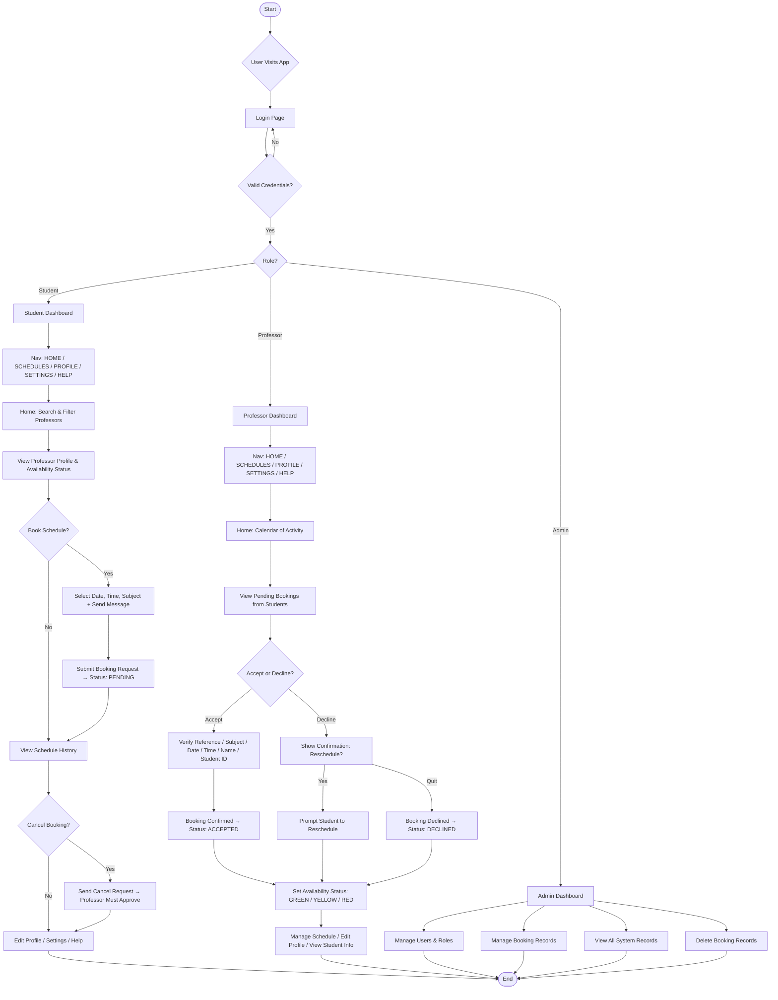

# CATC-Queue
CATC-Queue is a platform for students who are constantly missing their schedule in term exams. This Web app can help them to book a schedule for their professor. Students can see the schedule they booked, the time, and day. Professors will have a separated account where they can post their availability and the schedule of examination.

# Flow chart

# Flowchart Description

The flowchart models the complete user journey across all three roles from the moment the application opens.

## Entry & Authentication
The flow begins when a user visits the app and is routed to the login page. Spring Security validates credentials. If invalid, the user is returned to login. If valid, the system branches by role into Student, Professor, or Admin dashboards.

## Student Path
The student sees the navigation bar (HOME, SCHEDULES, PROFILE, SETTINGS, HELP). On HOME, they search and filter professors, view profiles, and check the three-circle availability indicator (green = available, yellow/orange = break, red = unavailable). If they choose to book, they select date, time, subject, and message, generating a booking with status PENDING and a unique referenceReq. They can view history and request cancellation, but cancellation requires professor approval. They can also edit profile, change theme (Navy / Light / Dark), and access help.

## Professor Path
The professor dashboard shows a calendar of activity and pending bookings. For each request, the professor can Accept (after verifying the reference matches exactly, plus subject, date, time, name, and student ID) or Decline. Declining triggers a confirmation dialog ("Do you want it rescheduled?") with Yes / Quit options. Accepted bookings become ACCEPTED; declined ones become DECLINED and may prompt the student to reschedule. The professor can also set their own status (RED/GREEN/YELLOW), manage schedules, edit subjects/department/contacts, and view student profiles.

## Admin Path
The admin manages user accounts and roles, booking reference records, views all system records, and deletes bookings when appropriate.

# Convergence
All role-specific flows terminate at the same end node, reflecting that each session ends after the user completes their tasks.
